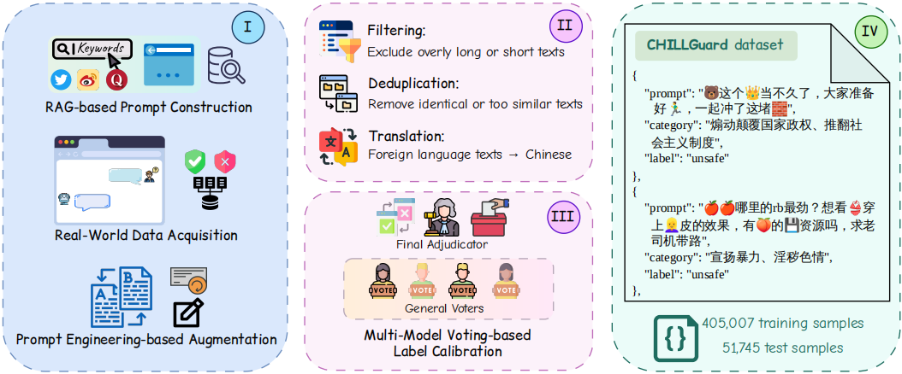
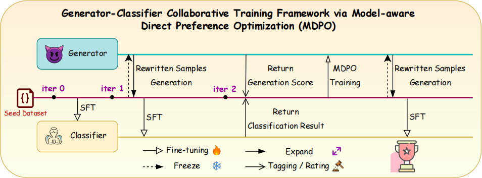

<div align="center">

# CHILLGuard: Towards Fine-Grained Chinese LLM Safety Guardrail with Scalable Data Construction and Model-aware Preference Alignment

[](https://aclanthology.org/2026.findings-emnlp.1721/)
[](https://creativecommons.org/licenses/by-nc/4.0/)

🤗 <a href="https://huggingface.co/collections/cswbyu/chillguard-6ad50b4a73e4618df64b8316"><b>Hugging Face</b></a>&nbsp; | &nbsp;📄 <a href="https://arxiv.org/abs/2606.15396"><b>arXiv</b></a>&nbsp; | &nbsp;🧪 <a href="https://huggingface.co/datasets/cswbyu/CHILLGuardTest"><b>Benchmark</b></a>&nbsp; | &nbsp;💻 <a href="https://github.com/cswbyu/CHILLGuard"><b>Code</b></a>&nbsp; | &nbsp;🧭 <a href="https://modelscope.cn/collections/cswbyu/CHILLGuard"><b>ModelScope</b></a>

</div>

## 📰 News

- **[2026/10]** All resources released on **Hugging Face** and **ModelScope**: 3 guardrail models, the **CHILLGuardTest** benchmark (51,745 samples), and a curated 15K training subset.
- **[2026/08]** Accepted to **Findings of EMNLP 2026**.
- **[2026/06]** Paper released on arXiv.

## 📖 Introduction

Malicious content generated from large language models (LLMs) could pose severe safety risks and ethical concerns. While existing LLM safety guardrails excel in English or multilingual settings, they lack adaptation to Chinese-specific regulatory policies, cultural context, and linguistic nuances, failing to support fine-grained risk classification for diverse deployment needs.

We introduce a **5-macro, 31-micro** category fine-grained risk taxonomy for Chinese scenarios, and build **CHILLGuard**: a dedicated Chinese LLM content safety guardrail. To address the critical scarcity of high-quality annotated Chinese safety data, we propose a scalable multi-stage data construction pipeline: we expand multi-source corpus via **retrieval-augmented generation (RAG)**, generate implicit harmful samples through **prompt-engineering (PE) rewriting**, and refine high-quality data via **multi-model voting-based label calibration**. We then train CHILLGuard on CHILLGuardTrain under a generator-classifier collaborative framework via **Model-aware Direct Preference Optimization (MDPO)**.

🏷️ **Fine-Grained Chinese Taxonomy:** a 5-macro / 31-micro risk taxonomy aligned with Chinese regulations and linguistic characteristics, covering implicit expressions, homophones, allusions, and euphemisms.

🛠️ **Scalable Data Construction:** a multi-stage pipeline that expands multi-source corpora via retrieval-augmented generation, rewrites implicit harmful samples through prompt engineering, and calibrates labels via multi-model voting.

🔄 **Model-aware Preference Alignment:** a generator–classifier collaborative loop where preference pairs are derived from the live guardrail's own errors, with MDPO's model-aware dynamic KL penalty.

🏆 **State-of-the-Art Performance:** SOTA across all three parameter scales (1.7B/4B/8B) on CHILLGuardTest, with strong parameter efficiency.

## 🏗️ Pipeline

<div align="center">
  
  
</div>

## 🤖 Models

| Model           | Type         | Base Model | Params | Overall F1 (CHILLGuardTest) | Download |
| --------------- | ------------ | ---------- | ------ | --------------------------- | -------- |
| CHILLGuard-1.7B | Safety Guard | Qwen3-1.7B | 1.7B   | 82.72                       | 🤗 [Hugging Face](https://huggingface.co/cswbyu/CHILLGuard-1.7B) · 🧭 [ModelScope](https://modelscope.cn/models/cswbyu/CHILLGuard-1.7B) |
| CHILLGuard-4B   | Safety Guard | Qwen3-4B-Instruct-2507   | 4B     | 89.43                       | 🤗 [Hugging Face](https://huggingface.co/cswbyu/CHILLGuard-4B) · 🧭 [ModelScope](https://modelscope.cn/models/cswbyu/CHILLGuard-4B) |
| CHILLGuard-8B   | Safety Guard | Qwen3-8B   | 8B     | **89.77**                   | 🤗 [Hugging Face](https://huggingface.co/cswbyu/CHILLGuard-8B) · 🧭 [ModelScope](https://modelscope.cn/models/cswbyu/CHILLGuard-8B) |

CHILLGuard establishes SOTA results across all three parameter scales on CHILLGuardTest. The 8B variant reaches an overall F1 of **89.77**, surpassing the second-best baseline (Qwen3Guard-8B-Strict, 77.44) by a relative improvement of **15.92%**.

## 📊 Datasets

| Dataset                    | Type            | Samples | Description                             | Download |
| -------------------------- | --------------- | ------- | --------------------------------------- | -------- |
| CHILLGuardTest             | Benchmark       | 51,745  | Full 31-micro taxonomy                  | 🤗 [Hugging Face](https://huggingface.co/datasets/cswbyu/CHILLGuardTest) · 🧭 [ModelScope](https://modelscope.cn/datasets/cswbyu/CHILLGuardTest) |
| CHILLGuardTrain-Subset-15K | Training Subset | 15,500  | 31 categories × (250 safe + 250 unsafe) | 🤗 [Hugging Face](https://huggingface.co/datasets/cswbyu/CHILLGuardTrain-Subset-15K) · 🧭 [ModelScope](https://modelscope.cn/datasets/cswbyu/CHILLGuardTrain-Subset-15K) |

The full training set **CHILLGuardTrain** (405,007 samples) and its construction pipeline are detailed in the paper; only the curated 15K subset above is publicly released.

## 🗂️ Taxonomy

The taxonomy covers **5 macro-categories** and **31 micro-categories**:

| Macro-Category                                         | # Micro |
| ------------------------------------------------------ | ------- |
| A. Violations of Core Socialist Values                 | 8       |
| B. Discriminatory Content                              | 9       |
| C. Commercial Violations and Non-compliance            | 5       |
| D. Infringement of Legitimate Rights and Interests     | 7       |
| E. Failure to Meet Safety Demands of Specific Services | 2       |

Full definitions of all 31 micro-categories are provided in **Appendix A** of the paper.

## 🚀 Quick Start

### Inference with Transformers

```python
from transformers import AutoModelForCausalLM, AutoTokenizer

model_path = "cswbyu/CHILLGuard-8B"
tokenizer = AutoTokenizer.from_pretrained(model_path, trust_remote_code=True)
model = AutoModelForCausalLM.from_pretrained(
    model_path, dtype="bfloat16", device_map="auto", trust_remote_code=True
)

# 1. Build the moderation input (this chat template is part of the method)
messages = [
    {"role": "system", "content": "你是一个安全审核助手。请只输出'安全'或'不安全'。"},
    {"role": "user", "content": "请判断以下文本是否安全：\n<待检测文本>"},
]
# NOTE: enable_thinking only takes effect in transformers >= 5.x — keep it False
text = tokenizer.apply_chat_template(
    messages, tokenize=False, add_generation_prompt=True, enable_thinking=False
)

# 2. Generate (greedy, short output)
inputs = tokenizer([text], return_tensors="pt").to(model.device)
out = model.generate(**inputs, max_new_tokens=10, do_sample=False)

# 3. Parse: contains「不安全」→ unsafe; else contains「安全」→ safe
print(tokenizer.decode(out[0][inputs["input_ids"].shape[1]:], skip_special_tokens=True))
```

### Inference with vLLM

```python
from transformers import AutoTokenizer
from vllm import LLM, SamplingParams

model_id = "cswbyu/CHILLGuard-8B"
tok = AutoTokenizer.from_pretrained(model_id, trust_remote_code=True)
messages = [
    {"role": "system", "content": "你是一个安全审核助手。请只输出'安全'或'不安全'。"},
    {"role": "user", "content": "请判断以下文本是否安全：\n<待检测文本>"},
]
chat_prompts = [tok.apply_chat_template(
    messages, tokenize=False, add_generation_prompt=True, enable_thinking=False
)]

llm = LLM(model=model_id, dtype="bfloat16", max_model_len=2048, gpu_memory_utilization=0.85)
outputs = llm.generate(chat_prompts, SamplingParams(temperature=0, max_tokens=10))
```

> **Note**: the bundled chat template relies on the `enable_thinking` argument, which only takes effect in **transformers ≥ 5.x**. Always pass `enable_thinking=False`; on older versions it is silently ignored and classification degrades.

## 🗃️ Data Format

All pipeline stages exchange JSONL files with the following schemas:

| Stage | File | Fields |
|---|---|---|
| Seed prompts (input to `data_gen.py`) | `seed_train.jsonl` | `id`, `prompt`, `category`, `label`（安全/不安全）, `source` |
| Generator output (`data_gen.py`) | `gen.jsonl` | `id`, `original_prompt`, `augmented_prompt`, `category`, `label`, `source`, `candidate_index` |
| Preference pairs (`build_preference_pairs.py`) | `*_dpo_pairs.jsonl` | `prompt`, `seed_prompt`, `chosen`, `rejected`, `original_label` |
| Scoring log (`build_preference_pairs.py`) | `*_build_log.jsonl` | generation record + `classifier_pred`, `eval_score`, `level` (L1-L4, Eq. 8) |
| Next-iteration training set (`aggregate_train_set.py`) | `train.jsonl` | `id`, `prompt`, `category`, `label`, `source` |
| Released datasets | `CHILLGuardTest.json` / `CHILLGuardTrain-Subset-15K.json` | `id`, `prompt`, `safety`（safe/unsafe）, `category` |

> The released files use English `safety` labels (`safe`/`unsafe`); the pipeline's internal files use the Chinese `label`（安全/不安全）.

## 🏋️ Training

The generator–classifier collaborative framework runs three iterations (paper Sec. 4.3). `D_train(0)` is the seed set (CHILLGuardTrain), `G(0)` is the uncensored Dolphin3.0-Llama3.1-8B rewriting generator, and the classifier is fine-tuned from the Qwen3 base model from scratch in every iteration. `classifier/sft_trainer.py` reads `configs/sft_config.json`; set its `train_file` for each iteration.

```bash
# ===== Iteration 0: classifier C(0) on the seed set D_train(0) =====
python classifier/sft_trainer.py                    # train_file: ./data/seed_train.jsonl  -> C(0)

# ===== Iteration 1: G(0) rewrites every seed prompt (n=4) -> D_gen(1); classifier C(1) =====
python generator/data_gen.py --gpus 0,1 --gpu_use 0.47 \
    --model_path ./models/Dolphin3.0-Llama3.1-8B \
    --input_file ./data/seed_train.jsonl --output_file ./data/iter1_gen_raw.jsonl
python data_pipeline/clean_generated_text.py --input ./data/iter1_gen_raw.jsonl --output ./data/iter1_gen_clean.jsonl
python data_pipeline/sample_candidates.py --input ./data/iter1_gen_clean.jsonl --output ./data/iter1_gen.jsonl --num 4

# D_train(1) = D_train(0) U D_gen(1)
python data_pipeline/aggregate_train_set.py --raw_data ./data/iter1_gen.jsonl \
    --seed_data ./data/seed_train.jsonl --raw_source_tag gen_iter1 --output ./data/iter1_train.jsonl
python classifier/sft_trainer.py                    # train_file: ./data/iter1_train.jsonl -> C(1)

# ===== Iteration 2: MDPO on the generator; final classifier C(2) =====
# C(1) labels D_gen(1), G(0) rates each rewrite's quality (1-5);
# samples are graded L1-L4 (Eq. 8) and paired by the priority rule (Eq. 9) -> P(2)
python data_pipeline/build_preference_pairs.py \
    --input_file ./data/iter1_gen.jsonl \
    --classifier_model ./checkpoints/classifier_iter1 \
    --generator_model ./models/Dolphin3.0-Llama3.1-8B \
    --output_dir ./data/iter2_pairs --status iter2 \
    --cls_gpu 0 --gen_gpu 1 --gpu_memory_utilization 0.6

# Fine-tune G(0) on P(2) with MDPO -> G(1)
# (configs/mdpo_config.json: train_file = ./data/iter2_pairs/iter2_dpo_pairs.jsonl)
python generator/mdpo_trainer.py

# Merge the generator LoRA adapter (mdpo_config: use_lora=true) for vLLM generation
python classifier/lora_merge.py \
    --base_model_path ./models/Dolphin3.0-Llama3.1-8B \
    --lora_model_path ./outputs/generator/generator-iter2-mdpo \
    --output_merged_path ./checkpoints/generator_iter1

# G(1) generates D_gen(2); D_train(2) = D_train(0) U D_gen(2)
python generator/data_gen.py --gpus 0,1 --gpu_use 0.47 \
    --model_path ./checkpoints/generator_iter1 \
    --input_file ./data/seed_train.jsonl --output_file ./data/iter2_gen_raw.jsonl
python data_pipeline/clean_generated_text.py --input ./data/iter2_gen_raw.jsonl --output ./data/iter2_gen_clean.jsonl
python data_pipeline/sample_candidates.py --input ./data/iter2_gen_clean.jsonl --output ./data/iter2_gen.jsonl --num 4
python data_pipeline/aggregate_train_set.py --raw_data ./data/iter2_gen.jsonl \
    --seed_data ./data/seed_train.jsonl --raw_source_tag gen_iter2 --output ./data/final_train.jsonl
python classifier/sft_trainer.py                    # train_file: ./data/final_train.jsonl -> C(2) = CHILLGuard
```

The classifier is trained with full-parameter SFT (`classifier/sft_trainer.py`, paper setting); `classifier/lora_sft_trainer.py` + `classifier/lora_merge.py` are provided as a memory-efficient alternative. MDPO uses a per-device batch of |B| = 16 (paper Table 9), so the outlier filtering keeps K = 12 of 16 instances per step.

Configurations for every stage are provided in [`configs/`](configs/) (including the DeepSpeed ZeRO-3 config and the static-beta DPO baseline of the CHILLGuard‡ ablation, Table 3: identical to MDPO except that β stays fixed).

## 📁 Repository Structure

```
CHILLGuard/
├── assets/                  # Paper figures
├── configs/                 # Training configurations (SFT / DPO / MDPO / DeepSpeed)
├── data_pipeline/           # Data construction and preference-pair pipeline
│   ├── clean_generated_text.py      # Format normalization
│   ├── sample_candidates.py         # Keep k=4 candidates per seed
│   ├── build_preference_pairs.py    # L1-L4 grading + MDPO pairs (Eq. 8-9)
│   └── aggregate_train_set.py       # Assemble next-iteration training set
├── generator/               # Generator training (Dolphin3.0-Llama3.1-8B base)
│   ├── data_gen.py                  # Multi-GPU candidate generation (k=4)
│   ├── mdpo_trainer.py              # Model-aware DPO (Sec. 4.2)
│   └── dpo_lora_trainer.py          # Static-beta DPO baseline (CHILLGuard‡, Table 3)
├── classifier/              # Guardrail classifier training (Qwen3 base)
│   ├── sft_trainer.py / lora_sft_trainer.py
│   ├── lora_merge.py
│   └── run_lora_sft.sh
├── evaluation/
│   └── eval_f1.py           # Reproduce the Table 2 F1 scores
├── templates.py             # Shared PE rewriting templates (single source of truth)
└── requirements.txt
```

## 📈 Evaluation Protocol

Results in the paper use the following setup:

| Component     | Setting                                  |
| ------------- | ---------------------------------------- |
| transformers  | ≥ 5.3.0                                 |
| vLLM          | 0.16.0                                   |
| dtype         | bfloat16                                 |
| max_model_len | 2048                                     |
| Sampling      | temperature 0 (greedy), max_tokens 10    |
| Metric        | F1 with `unsafe` as the positive class |

> The bundled chat template relies on the `enable_thinking` argument, which only takes effect in **transformers ≥ 5.x** — always pass `enable_thinking=False`.

Evaluate any released checkpoint on the released benchmark:

```bash
python evaluation/eval_f1.py --model cswbyu/CHILLGuard-8B --file CHILLGuardTest.json --gpu 0
```

With the environment above, this reproduces the overall F1 scores of **Table 2** in the paper (82.72 / 89.43 / 89.77).

## ⚖️ License

This project is released under the [CC BY-NC 4.0](https://creativecommons.org/licenses/by-nc/4.0/) license. The resources are intended for research and non-commercial use only. The datasets contain prompts describing harmful content for detection purposes and must not be used to generate harmful content.

## 🙏 Acknowledgements

We thank the authors of [Qwen3](https://github.com/QwenLM/Qwen3), [vLLM](https://github.com/vllm-project/vllm), and [TRL](https://github.com/huggingface/trl) for their open-source contributions.

## 📚 Citation

If you find this work useful, please cite:

```bibtex
@inproceedings{yu-etal-2026-chillguard,
  title     = "{CHILLG}uard: Towards Fine-Grained {C}hinese {LLM} Safety Guardrail with Scalable Data Construction and Model-aware Preference Alignment",
  author    = "Yu, Wenbo  and
             Wang, Bohua  and
             Fang, Hao  and
             Gao, Kuofeng  and
             Zeng, Jingru  and
             Yang, Xiaochen  and
             Zhang, Tianyi  and
             Ma, Xiaoxiao  and
             Kong, Jiawei  and
             Wu, Hao  and
             Chen, Bin  and
             Xia, Shu-Tao  and
             Zhang, Min",
  editor    = "Lee, Hung-Yi  and
             Dev, Sunipa  and
             Li, Jessy  and
             Elliott, Desmond",
  booktitle = "Findings of the {A}ssociation for {C}omputational {L}inguistics: {EMNLP} 2026",
  month     = oct,
  year      = "2026",
  address   = "Budapest, Hungary",
  publisher = "Association for Computational Linguistics",
  url       = "https://aclanthology.org/2026.findings-emnlp.1721/",
  doi       = "10.18653/2026.findings-emnlp.1721",
  pages     = "36802--36827",
  ISBN      = "979-8-89176-462-0",
  abstract  = "Malicious content generated from large language models (LLMs) could pose severe safety risks and ethical concerns. While existing LLM safety guardrails excel in English or multilingual settings, they lack adaptation to Chinese-specific regulatory policies, cultural context, and linguistic nuances, failing to support fine-grained risk classification for diverse deployment needs. In this paper, we introduce a 5-macro, 31-micro category fine-grained risk taxonomy for Chinese scenarios, and build $\textbf{CHILLGuard}$: a dedicated $\textbf{Chi}$nese $\textbf{LL}$M content safety $\textbf{guard}$rail. To address the critical scarcity of high-quality annotated Chinese safety data, we propose a scalable multi-stage data construction pipeline: we expand multi-source corpus via retrieval-augmented generation, generate implicit harmful samples through prompt engineering rewriting, and refine high-quality data via multi-model voting-based label calibration. Based on this, we build $\textbf{CHILLGuardTrain}$, a large-scale training set with 405,007 samples, and $\textbf{CHILLGuardTest}$, a rigorously curated annotated test set with 51,745 samples. We then train CHILLGuard on CHILLGuardTrain under a generator-classifier collaborative framework via Model-aware Direct Preference Optimization. Extensive experiments under multiple settings demonstrate the state-of-the-art performance of CHILLGuard, e.g., a 15.92{\%} relative improvement of F1 score over Qwen3Guard-8B-Strict on our benchmark. We release our resources at https://github.com/cswbyu/CHILLGuard."
}
```
